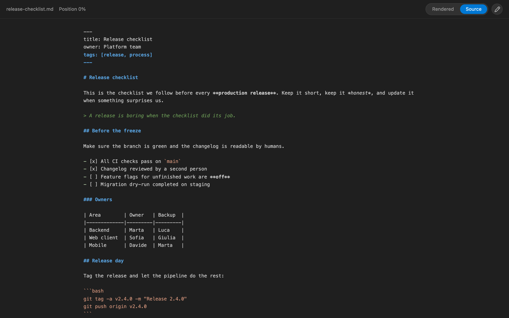

# Inkstand

**A beautiful rendered view for Markdown in VS Code.** Inkstand opens `.md` files already rendered — headings, tables, task lists, highlighted code — with a source view, a table of contents and side-by-side editing, in light and dark themes.


| Light theme | Source view |
|---|---|
|  |  |

## Features

- **Opens rendered by default.** `.md` and `.markdown` files open straight into the rendered view — no raw `#` and `**` first.
- **Rendered / Source switch.** Flip between the rendered page and the highlighted Markdown source in the same panel. Each mode remembers its scroll position.
- **Table of contents.** The **Contents** button opens a side panel with the H1–H3 headings. The current section is highlighted and clicking a heading jumps to it.
- **Reading position.** The toolbar shows the section you are in (e.g. `Release checklist › Before the freeze`) and how far you have read (`Position 46%`).
- **Side-by-side editing.** The pencil opens VS Code's text editor next to the rendered view, which updates live as you type. Close the text tab when you are done.
- **Follows your theme.** Colors and fonts come from your VS Code theme, including high-contrast themes.
- **YAML front matter** is shown as a tidy key/value table.
- **Safe by default.** Raw HTML inside Markdown is shown as text, scripts never run, and only HTTPS remote images are loaded.

## Usage

| Action | How |
|---|---|
| Switch Rendered / Source | Click the switch in the toolbar, or `Cmd+Alt+M` (`Ctrl+Alt+M` on Windows/Linux) |
| Show or hide the table of contents | Click **Contents** |
| Edit the file | Click the pencil: the text editor opens beside the rendered view |
| Go back from the text editor | Close the text tab, click the eye icon (**Back to Rendered View**) or press `Cmd+Alt+M` |

### Commands

- `Markdown: Toggle Rendered / Source`
- `Markdown: Edit Side by Side`
- `Markdown: Back to Rendered View`

### Settings

| Setting | Default | Description |
|---|---|---|
| `inkstand.enabled` | `true` | Open Markdown files directly in the rendered view. When `false`, they open as text and Inkstand is used only when you ask for it. |

Inkstand also hides VS Code's editor-type dropdown in the breadcrumbs (`breadcrumbs.showEditorType`) by default. Set it back to `true` in your settings if you want it.

## Install

Inkstand is not on the Marketplace yet. To build and install it from source you need Node.js 18 or newer:

```bash
git clone https://github.com/lustri2002/inkstand.git
cd inkstand
npm install
npm run package
code --install-extension inkstand-*.vsix
```

Then reload the VS Code window.

## Development

```bash
npm install
npm run compile     # bundle the extension and the webview script into dist/
npm run typecheck   # TypeScript checks
npm test            # unit tests (vitest)
```

Press `F5` in VS Code to launch an Extension Development Host. `samples/` contains Markdown files to try it with.

## Credits

The look of the toolbar, the source view and the table of contents is inspired by [FluxMarkdown](https://github.com/xykong/flux-markdown), a Markdown viewer for macOS. Inkstand is an independent implementation and contains no FluxMarkdown code.

## License

[MIT](LICENSE)
