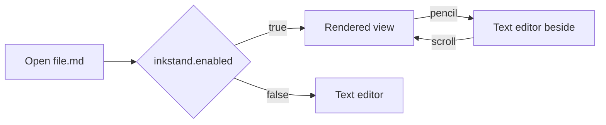
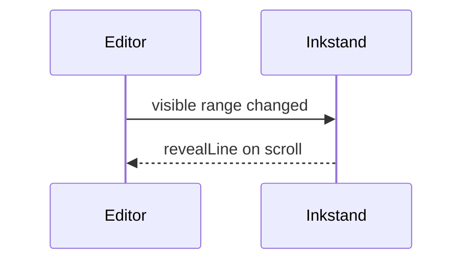

# Inkstand features

A tour of what the rendered view can show. Open the text editor beside it (the pencil) and scroll either side: the other follows. Double-click a paragraph to jump to its source.

## Tasks

- [x] Write the release notes
- [ ] Tick this box: the file changes to `[x]`
- [ ] Press `Cmd+Z` / `Ctrl+Z` to undo it

## Alerts

> [!NOTE]
> Useful information that readers should know, even when skimming.

> [!TIP]
> Helpful advice for doing things better or more easily.

> [!IMPORTANT]
> Key information readers need to know to achieve their goal.

> [!WARNING]
> Urgent info that needs immediate attention to avoid problems.

> [!CAUTION]
> Advises about risks or negative outcomes of certain actions.

## Footnotes and emoji

Inkstand renders footnotes[^render] and emoji shortcodes :tada: :rocket:, while text smileys stay as they are :)

[^render]: Like this one. The arrow takes you back to the text.

## Diagrams





## Math

The area of a circle is $A = \pi r^2$, and Euler's identity is $e^{i\pi} + 1 = 0$. Prices like $5 and $10 stay text.

$$
\int_0^\infty e^{-x^2}\,dx = \frac{\sqrt{\pi}}{2}
$$

```math
\begin{aligned}
\nabla \cdot \mathbf{E} &= \frac{\rho}{\varepsilon_0} \\
\nabla \times \mathbf{B} &= \mu_0 \mathbf{J} + \mu_0 \varepsilon_0 \frac{\partial \mathbf{E}}{\partial t}
\end{aligned}
```

## Code

```ts
export function greet(name: string): string {
  return `Hello, ${name}!`;
}
```

```bash
npm install
npm test
```

## Long section for scrolling

Paragraph one. Scroll sync interpolates between blocks, so long sections still line up with the text editor.

Paragraph two. Lorem ipsum dolor sit amet, consectetur adipiscing elit, sed do eiusmod tempor incididunt ut labore et dolore magna aliqua.

Paragraph three. Ut enim ad minim veniam, quis nostrud exercitation ullamco laboris nisi ut aliquip ex ea commodo consequat.

Paragraph four. Duis aute irure dolor in reprehenderit in voluptate velit esse cillum dolore eu fugiat nulla pariatur.

Paragraph five. Excepteur sint occaecat cupidatat non proident, sunt in culpa qui officia deserunt mollit anim id est laborum.
